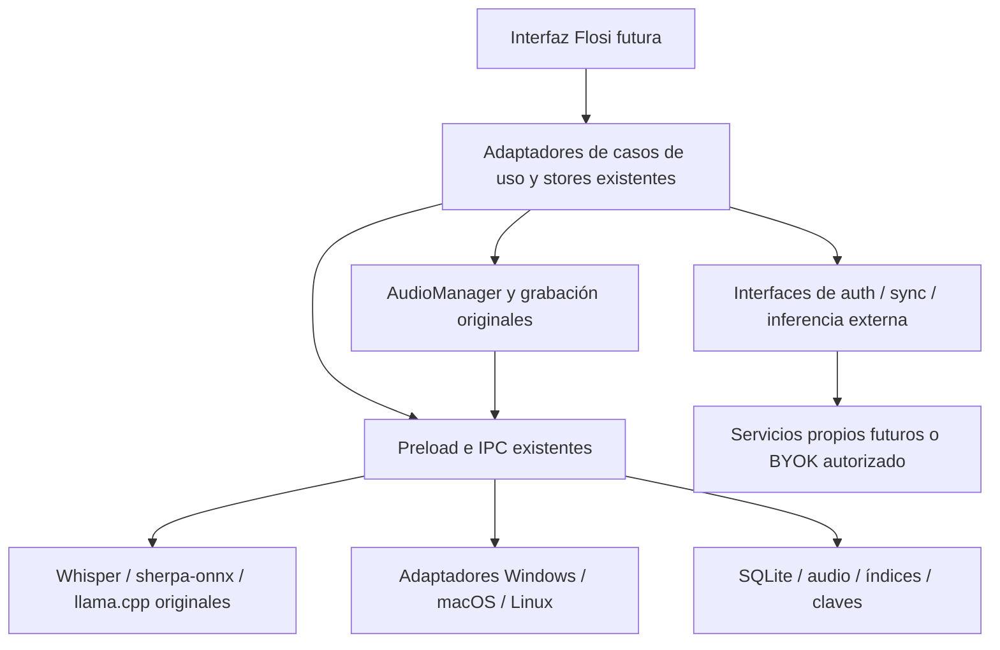

# Flosi — arquitectura y hoja de ruta técnica

Base de trabajo: `sseaccorp/openwhispr`, `codex/flosi-baseline`, v1.10.4 / `ba6d61820b4c56d7b08012c61c2ae6b43f3152f3`. Auditoría de código y plan; no se implementó rediseño, cuentas, suscripciones ni despliegue.

## Decisión técnica

Conservar las implementaciones reales de audio, ASR, LLM, reuniones, persistencia y helpers de plataforma. La separación principal ya existe: renderer React → API preload tipada → IPC/main → managers → procesos nativos/servidores locales. Reutilizar esos límites y corregirlos de forma incremental. `audioManager.js` vive entre hooks/UI y orquestación; `ipcHandlers.js` y `database.js` concentran muchas responsabilidades. Una extracción masiva ahora elevaría el riesgo sin resolver la validación pendiente.

La interfaz Flosi podrá usar adaptadores pequeños sobre stores y servicios existentes, manteniendo inicialmente nombres/eventos IPC y formatos persistidos. No hace falta un segundo motor de dictado ni portar Electron a móvil.

## Límites que deben quedar explícitos

- **Audio y motores:** managers de Whisper/Parakeet/llama, parámetros de inferencia, prompts y pipeline de texto se mantienen. Añadir en el futuro un manifiesto de artefactos/versiones/hashes por release y contratos de entrada/salida; no sustituir sus algoritmos. Backend CPU/GPU, modelo, idioma y cleanup son ejes independientes.
- **Casos de uso:** comenzar con adaptadores delgados para dictar, traducir, asistir, importar archivo, grabar reunión y exportar nota. Delegar al código existente; preservar cancelación, errores tipados, progreso, eventos de hotkey y semántica de finalización. No duplicar esos estados dentro de la nueva UI.
- **Plataforma:** encapsular lo que ya hacen key managers, clipboard, loopback, permissions, tray y autostart detrás de contratos de capacidades. Mantener implementaciones nativas y fallbacks. Windows 11 x64 es la primera aceptación; las demás plataformas conservan código sin declararse probadas.
- **Datos:** continuar SQLite y sus migraciones; introducir después namespace de producto para perfil, claves, modelos, índices y temporales con pruebas de migración y rollback. La migración de usuarios oficiales no está autorizada en esta fase. Separar identidad de QA de identidad comercial.
- **Servicios externos:** registrar interfaces actuales de `cloudApi`, `SyncService`, auth y scopes de inferencia. El backend propio deberá reproducir los contratos necesarios, incluidos revocación, conflictos, ACL, borrados y generación de sesión; cubrir el TODO S5 de paginación delta con timestamps empatados antes de aceptar sincronización. Cambiar URLs sin ese backend no proporciona paridad.
- **UI:** construir la experiencia Flosi solo una vez congelados los contratos y aceptado el flujo local en Windows. Mantener original disponible como referencia de regresión. Resolver derechos sobre recursos cuando se autorice la identidad nueva; no copiar fuentes/iconos con derechos inciertos.
- **Upstream:** guardar el SHA de origen, mantener cambios Flosi pequeños por preocupación, evitar formateo masivo y cambios de rutas en motores. Integrar correcciones upstream en ramas separadas, comparar manifiestos/outputs y pasar QA antes de incorporarlas. No enviar PR ni push al upstream.

## Fases, prioridades y criterios de aceptación

| Fase                                   | Prioridad y trabajo                                                                                                                                                                                                                                                                                     | Criterio de salida                                                                                                                                                                                                                                                                  |
| -------------------------------------- | ------------------------------------------------------------------------------------------------------------------------------------------------------------------------------------------------------------------------------------------------------------------------------------------------------- | ----------------------------------------------------------------------------------------------------------------------------------------------------------------------------------------------------------------------------------------------------------------------------------- |
| 0. Congelar y registrar                | **P0.** Esta auditoría: baseline exacta, branch/worktree, lockfile, verificación de red, checks, inventario y evidencias.                                                                                                                                                                               | Cuatro documentos disponibles, comandos/resultados trazables y diferencias con el checkout inicial explícitas. Los límites pendientes no se presentan como aprobados.                                                                                                               |
| 1. Reproducibilidad y seguridad        | **P0.** Cerrar fallos del entorno y tests que queden; inventariar binarios y descargas mutables; revisar advisories actuales. Comparar correcciones de seguridad existentes en el fork más nuevo, sin saltar de versión a ciegas. Separar rama de referencia 1.10.4 de rama candidata con correcciones. | Instalación desde lockfile, checks y pruebas de DB completos; manifiesto de artefactos con SHA-256; triage de cada aviso alto/crítico, corrección o justificación de alcance revisada. No `npm audit fix --force` ni debilitar controles.                                           |
| 2. Viabilidad comercial/licencias      | **P0 antes de distribuir.** Inventario del paquete real y modelos; MIT/NOTICE, GPL FFmpeg, AGPL Tinfoil/verifier, MPL, pesos CC-BY/SA y gated, Nucleo/Yowza, recursos de proveedores, NirCmd y otros sidecars.                                                                                          | Estrategia de licencia/distribución aprobada y atribuciones/código fuente correspondiente cuando aplique; derechos demostrados sobre recursos. Si hacen falta sustituciones, propuesta aislada y justificación revisable que conserve funciones. Ninguna sustitución aplicada aquí. |
| 3. Aceptación local Windows            | **P0.** Ejecutar `FLOSI_WINDOWS_QA.md` con cuenta QA y hardware físico; benchmark pareado v1.10.4, micrófono/GPU/hotkeys/pegado, reuniones, datos y estabilidad.                                                                                                                                        | Evidencia de cada fila, corpus/hash/settings, métricas ES/EN y resultados de recuperación. Sin pérdida de datos; umbrales acordados satisfechos o limitaciones explícitamente aceptadas.                                                                                            |
| 4. Aislamiento de producto y contratos | **P1.** Adaptadores mínimos, capacidades por plataforma, namespace Flosi y políticas de servicios. Revisión de `sandbox:false`/`webSecurity:false` heredados: trasladar peticiones al main con validación y CSP en una tarea dedicada si se confirma necesario, sin romper providers.                   | Tests de contratos y regresión, aislamiento de perfil/secretos/cache/actualización demostrado; preservación de motores/prompts. La app candidata no toma datos ni identidad oficial.                                                                                                |
| 5. Interfaz Flosi                      | **P1, NO iniciada.** Rediseño sobre los contratos aceptados; respetar estados, accesibilidad y localización.                                                                                                                                                                                            | Igualdad funcional de tareas y métricas acordadas frente a la referencia; ningún cambio visual esconde pérdidas de funciones o errores. Recursos propios/legalmente reutilizables.                                                                                                  |
| 6. Servicios propios y monetización    | **P2, NO iniciada.** Diseñar backend auth/sync, cuentas/equipos, permisos, compartir, cobro y cuotas. Evaluar BYOK/local como opciones de producto independientes del backend.                                                                                                                          | Contratos y pruebas E2E multiusuario, privacidad/retención, revocación, backups, límites y costes; proveedores y registros OAuth propios. No reutilizar tokens, cuentas, marca ni planes OpenWhispr.                                                                                |
| 7. Distribución Windows                | **P1 después de seguridad/legal/QA.** Identidad de aplicación, GUID tray, protocolo, editor, certificados, feed de actualización y CI propios; NSIS y verificación en máquinas limpias.                                                                                                                 | Instalación/update/uninstall y coexistencia verificadas, firma válida, inventario/avisos entregados, rollback ensayado. Publicación y merge requieren una decisión posterior; no son parte de esta tarea.                                                                           |
| 8. macOS y móvil                       | **P2/P3.** macOS: permisos, Metal, firma/notarización y helper Swift. Móvil: evaluar Expo/native iOS existente y Android por separado, incluyendo privacy/billing/teclado/IA local.                                                                                                                     | QA nativa por plataforma y derechos/servicios resueltos; iOS en dispositivos con extension, Android con compilación y matriz real antes de prometer soporte. No compartir ABIs ni afirmar que Electron funciona en iOS/Android.                                                     |

## Riesgos principales y mitigación

| Riesgo                                                                   | Impacto                                                                               | Mitigación concreta                                                                                                                                                                                   |
| ------------------------------------------------------------------------ | ------------------------------------------------------------------------------------- | ----------------------------------------------------------------------------------------------------------------------------------------------------------------------------------------------------- |
| MIT confundido con derechos del conjunto                                 | Distribución incompatible con objetivos de licencia cerrada o pérdida de atribuciones | Revisar GPL/AGPL/CC-BY-SA, binarios y assets antes de definir modelo comercial; preservar avisos y código correspondiente.                                                                            |
| Baseline antigua con advisories actuales                                 | Riesgo de seguridad previo al lanzamiento                                             | Congelar referencia; planificar actualización de dependencias en rama candidata y repetir regresiones. La auditoría npm no prueba explotabilidad en este cliente ni ausencia de problemas en motores. |
| Dependencias `latest`/`main`, releases mutables y compiladores distintos | Dos builds del mismo commit pueden comportarse distinto                               | Manifestar versiones/hashes reales y fijar descargas en un cambio posterior independiente; comparar con el instalador oficial antes de atribuir paridad al source.                                    |
| Auth/sync/Orukeet cloud no incluidos                                     | Botones y flujos que dependen del propietario dejan de funcionar                      | Inventario de capacidades/contratos; backend propio o BYOK autorizado en fase posterior. No prometer paridad cloud independiente.                                                                     |
| Validación Linux confundida con Windows                                  | Atajos, pegado, WASAPI/GPU/instalador fallan en clientes                              | Gate Windows físico, corpus pareado y evidencia por función.                                                                                                                                          |
| Canal development comparte cache/keyring                                 | Alteración de modelos o claves oficiales                                              | Cuenta QA separada; namespace/migración futura con rollback y pruebas.                                                                                                                                |
| Rediseño prematuro de managers monolíticos                               | Regresiones difíciles de atribuir                                                     | Adaptadores mínimos; no mover motores ni duplicar estados; comparar pipeline completo después de cada paso.                                                                                           |
| Claims de privacidad sin considerar postprocesado/móvil                  | Contenido sale del equipo pese a ASR local                                            | Verificar todos los scopes y red por proceso; revisión separada de Insights, Sentry y AppsFlyer existentes.                                                                                           |

## ¿Listos para el rediseño?

**Listos para planificarlo con estos límites; todavía no para iniciarlo como baseline de producción aceptada.** Antes deben cerrarse la aceptación local Windows, los resultados pendientes de pruebas, el triage de seguridad y las decisiones legales sobre dependencias/recursos. No se necesita una reescritura: el camino recomendado conserva la base técnica y abre la nueva UI cuando esas puertas sean verificables.
