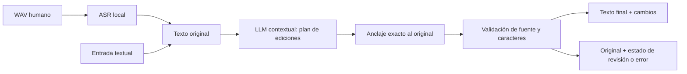

# Flosi Smart QA — motor experimental aislado

Recibe texto o voz humana y muestra el texto original junto a la corrección.
Se ejecuta como una aplicación local en el navegador, con ASR y corrección locales.
No abre Electron, no lee perfiles de Flosi QA, no configura atajos globales y no
inserta texto en otras aplicaciones. **No está aprobado para producción.**

Para Windows: [WINDOWS.md](WINDOWS.md). Para criterios de aceptación establecidos
antes de la evaluación final: [ACCEPTANCE.md](ACCEPTANCE.md).

El código es independiente del laboratorio histórico. Sus prompts, corpus,
evaluadores y resultados no se modifican. Las respuestas de experimentos nuevos
se guardan en carpetas nuevas de `evidence/`, con inputs, outputs completos,
parámetros, hashes, tiempos y uso real de tokens. Los artefactos históricos no
constituyen una validación ciega.



Cada edición indica un tramo único del original y las palabras que conserva.
El motor admite completar el anclaje hasta un reemplazo posterior **exacto y
único** observado en la fuente. Nunca resuelve dos coincidencias por adivinación.
Reconstruye el resto desde el texto original. No permite añadir o reordenar
palabras, modificar cifras o espacios técnicos retenidos, cruzar citas explícitas,
solapar ediciones ni eliminar la cola de una retirada o reemplazo final. Si el
modelo devuelve una respuesta inválida, un error, una truncación o incertidumbre,
conserva el original y lo señala. Se aplican límites de entrada, petición y tiempo.

Estas comprobaciones son una protección mecánica. **No demuestran por sí solas
que una supresión conserve el significado.** El LLM sigue siendo responsable de
delimitar el alcance y distinguir citas, contraste, adición y retractación. El
renderizado solo ajusta los bordes mínimos de prosa; no normaliza Unicode ni
espacios técnicos. Los patrones de identificación técnica no son un parser
exhaustivo de todos los lenguajes y comandos posibles.

La interfaz permite grabar un WAV PCM con AudioWorklet, abrir un WAV existente,
escribir texto, introducir una referencia y descargar evidencia. La persistencia
del audio es opcional. Por defecto, el procesamiento de inferencia queda en el
equipo. La opción explícita de Groq envía únicamente la transcripción; requiere
una credencial ya configurada y que el operador confirme su cuota gratuita.
No activa servicios, facturación ni modelos alternativos automáticamente.

No hay reintentos de inferencia ni cambios automáticos de proveedor. Un 401, 403,
429, 5xx, error de red o timeout detiene la sesión de peticiones del proveedor.
Para volver a probar tras resolver el problema hay que iniciar otra sesión. Un
fallback que aún contiene una decisión descartada cuenta como corrección fallida.

Pruebas locales de contratos y fallos, desde esta carpeta:

```sh
python -m unittest discover -s tests -v
```

En sandbox, estas pruebas necesitan comunicación loopback para la parte HTTP.
No necesitan inferencia ni acceso a Internet. Los HTTP simulados están etiquetados
como tests; las evaluaciones de calidad e informes de audio usan inferencias reales.

La medición automática compara secuencias COMPLETAS y ordenadas, además de cifras,
códigos y citas explícitas. No aprueba un texto por contener palabras esperadas.
Las coincidencias con anotaciones no equivalen a revisión humana independiente.
Los errores de ASR se miden antes de la corrección; el corrector no puede recuperar
con seguridad una palabra que no llegó a la transcripción.

La identidad del original se conserva cuando no hay supresiones reales. Esto
protege también comandos correctos que el detector técnico no conozca. Cuando
hay una reparación, se copia la grafía retenida; solo un espacio técnico único
puede restaurarse desde la fuente y nunca se adivina entre variantes. El motor
no reconstruye ortografías a partir de letras dictadas ni inventa una palabra
que no aparece en la fuente. Esta restricción reduce capacidades y sigue siendo
una limitación de producto, aunque previene cambios de significado sin evidencia.

El comparador por palabras no cubre toda la semántica de la puntuación: los casos
con puntuación material usan `exact=true`, y todos requieren revisión de contexto.

Para repetir una evaluación textual usando la aplicación ya arrancada (sin leer
su token privado), el runner `experiments/evaluate_via_ui.py` envía solo el texto
al backend. Las referencias permanecen fuera de las peticiones.
